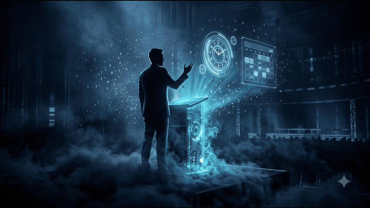
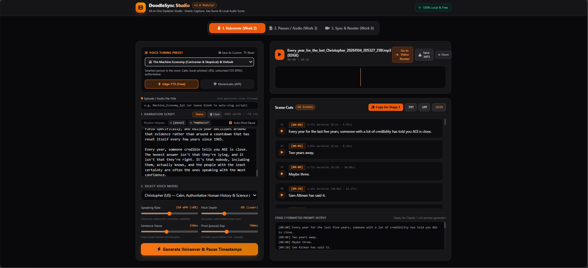
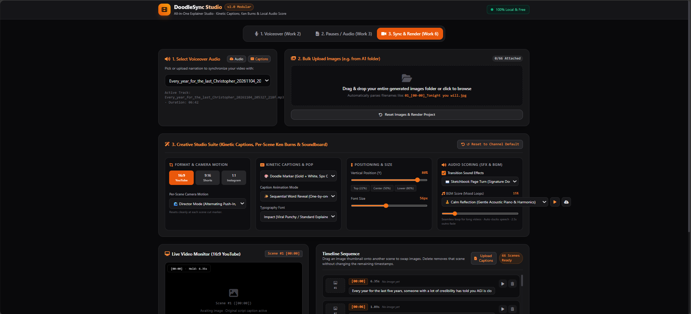
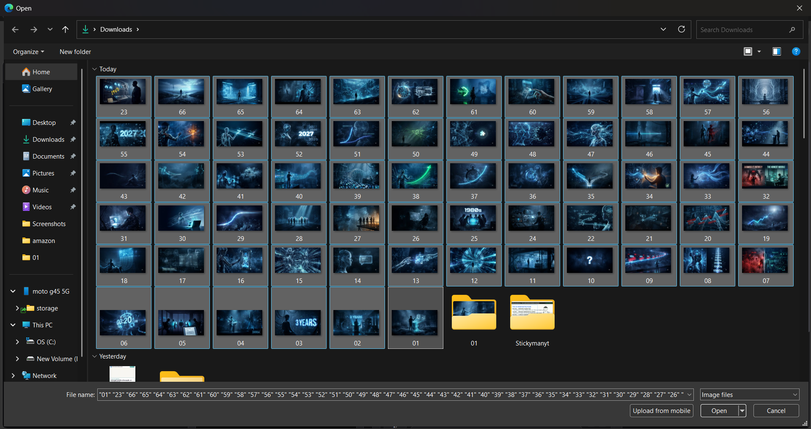
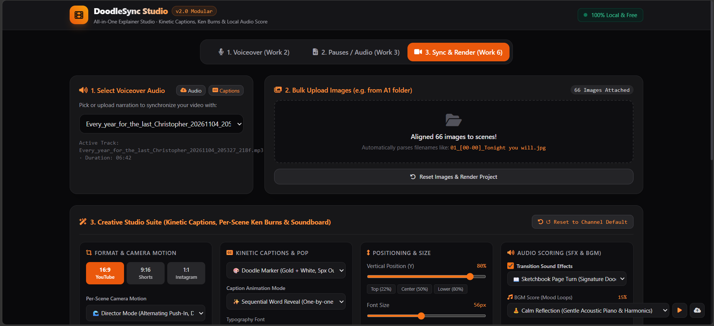
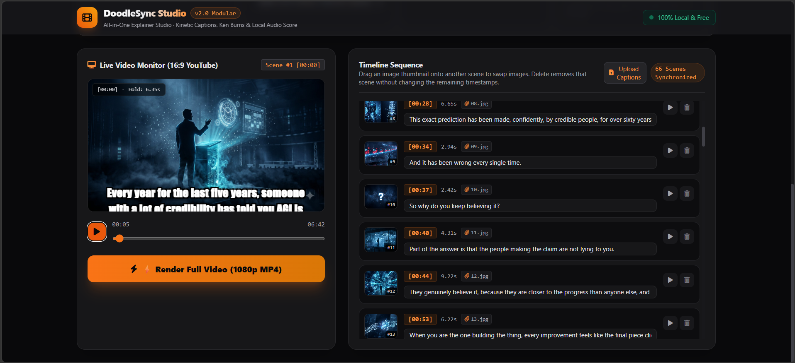
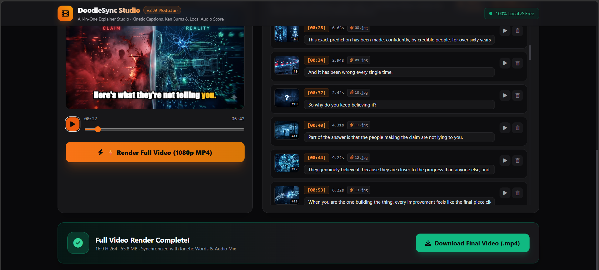
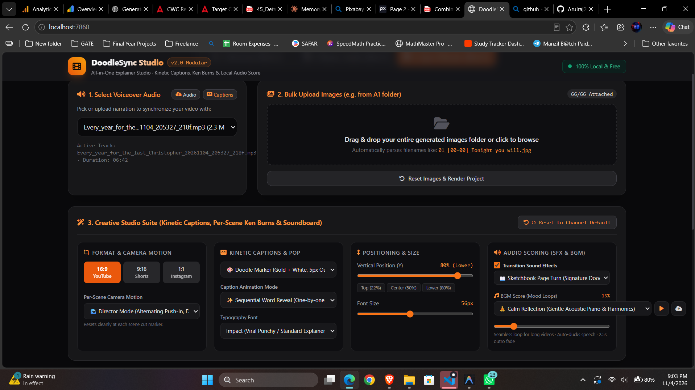
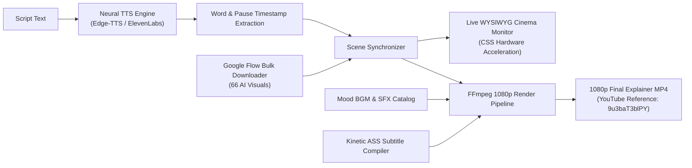

<div align="center">

# 🎬 DoodleSync Studio v2.0
### All-in-One AI Explainer & Stickman Video Production Engine

**Transform text scripts into broadcast-quality 1080p explainer videos with neural voiceover, frame-accurate pause alignment, Ken Burns camera motion, kinetic typography, and auto-ducked soundtrack scoring.**

[](https://python.org)
[](https://fastapi.tiangolo.com)
[](https://ffmpeg.org)
[](https://github.com/rany2/edge-tts)
[](https://github.com/SYSTRAN/faster-whisper)
[](LICENSE)

<br/>

[](https://buymeacoffee.com/x4kqsD0lkA)
[](mailto:arulraj8637@gmail.com)
[](https://github.com/Arulraj2001/explainer-video-engine)
[](https://youtu.be/9u3baT3blPY)

</div>

---

> [!IMPORTANT]
> ### 🚀 Get the Complete Source Code + All Future Updates
> - **🌍 International Creators:** **$5 USD** via **[buymeacoffee.com/x4kqsD0lkA](https://buymeacoffee.com/x4kqsD0lkA)**
> - **🇮🇳 Indian Creators:** **₹199 INR** (Direct UPI / GPay — contact [`arulraj8637@gmail.com`](mailto:arulraj8637@gmail.com))
> - **🔄 All Future Updates Included:** Every new feature, model upgrade, and engine optimization will be shared with you automatically at no extra cost.
> - **🛠️ Custom Feature Requests:** Need a specific style, custom TTS voice model, or workflow modification? I can build and customize specific features tailored for your channel or platform!
> - **⭐ Support the Project:** If you find this project impressive, please give it a Star (⭐) on GitHub!

---

## 📽️ Live Video Output Showcase

Watch the full-length 6-minute, 66-scene educational explainer video rendered completely by DoodleSync Studio:

<div align="center">
  <a href="https://youtu.be/9u3baT3blPY" target="_blank">
    
  </a>
  <p>
    ▶️ <strong><a href="https://youtu.be/9u3baT3blPY" target="_blank">Click Here to Watch the Full 1080p Video Output on YouTube</a></strong> (Reference: <code>https://youtu.be/9u3baT3blPY</code>)
  </p>
</div>

<br/>

### 🎬 Real-Time Kinetic Caption & Ken Burns Motion Preview
Notice the frame-accurate word highlighting and alternating Ken Burns motion generated automatically without keyframing:

<div align="center">
  
  <p><em>Real rendered output from <code>sample/output.mp4</code> — 1080p 30fps with kinetic typography and auto-ducked acoustic BGM.</em></p>
</div>

### 📊 Rendered Video Specifications
- **YouTube Full Video Reference:** [https://youtu.be/9u3baT3blPY](https://youtu.be/9u3baT3blPY)
- **Master Video File:** [`sample/output.mp4`](sample/output.mp4) (111 MB, 1080p H.264 / AAC)
- **Duration:** `06:42` (402.5 seconds total runtime)
- **Visual Assets:** Generated and downloaded using **Google Flow bulk downloader** (66 sequential AI-generated visuals)
- **Total Synchronized Scenes:** `66 Scenes` mapped automatically to spoken narration cuts
- **Audio Mix:** 100% Speech Volume + Dynamic Sidechain-Ducked Acoustic BGM (`Calm Reflection`) + Sketchbook Page Turn SFX at scene cuts
- **Subtitle Styling:** Sequential word-by-word reveal in golden yellow highlight (`#F5C518`), zero visual jump, pre-allocated layout

---

## 📸 Visual Studio Walkthrough

Here is the complete step-by-step workflow demonstrated in the `sample/` folder:

### 1️⃣ Phase 1 — Voiceover Generation & Voice-Tuning Suite
Fine-tune speaking rate, pitch depth, pause durations, and rhythm markup (`[pause]`, `*emphasis*`) with curated presets like *"The Machine Economy (Contrarian & Skeptical)"*.

<div align="center">
  
</div>

---

### 2️⃣ Phase 2 — Explainer Studio & Audio Timeline Setup
Pick generated or uploaded voiceover tracks, inspect duration (`06:42`), and configure aspect ratio (`16:9 YouTube`, `9:16 Shorts`, `1:1 Square`).

<div align="center">
  
</div>

---

### 3️⃣ Phase 3 — Bulk Visual Ingestion (Google Flow Bulk Downloader)
All 66 scene visual assets are generated and fetched using the **Google Flow bulk downloader** (as well as Midjourney, DALL-E, or Stable Diffusion) and selected in bulk directly from your downloads folder.

<div align="center">
  
</div>

---

### 4️⃣ Phase 4 — Automatic Timeline & Timestamp Alignment
The engine automatically maps image filenames to narration scenes, syncing all 66 scene cuts without manual editing.

<div align="center">
  
</div>

---

### 5️⃣ Phase 5 — WYSIWYG Real-Time Video Monitor
Test your video before rendering in the real-time player. Observe instant word-by-word lighting, kinetic pop, and live audio scrubbing.

<div align="center">
  
</div>

---

### 6️⃣ Phase 6 — Full Video Render & High-Speed Compilation
Compile full 1080p MP4 videos with hardware acceleration. Download finished videos ready for immediate YouTube or TikTok upload.

<div align="center">
  
</div>

---

### 7️⃣ Phase 7 — Studio Suite Overview
A streamlined dark-mode creative studio interface engineered for fast YouTube and Short-form video production.

<div align="center">
  
</div>

---

## ⚡ Key Capabilities & Superpowers

| Feature | DoodleSync Studio | Traditional Manual Workflow (CapCut / Premiere) |
| :--- | :--- | :--- |
| **Scene Alignment** | ⚡ **100% Automatic** (matches pauses & timestamps) | ⏳ 4-8 hours manual slicing per video |
| **Visual Ingestion** | ⚡ **Google Flow Bulk Downloader Integration** | ⏳ Manual file renaming & import |
| **Kinetic Captions** | ⚡ **Mathematical ASS Subtitles** (Sequential, Slam, Pop) | ⏳ Manual keyframing or paid cloud exports |
| **Camera Motion** | ⚡ **True Ken Burns Director Mode** (alternating push/pan) | ⏳ Manual scale/position keyframing on every cut |
| **BGM Auto-Ducking** | ⚡ **Broadcast Sidechain Compression** in FFmpeg | ⏳ Manual volume keyframe ducking |
| **Cost** | 💸 **One-time $5 / ₹199 (Lifetime)** | 💳 \$20–\$60/month subscriptions |
| **Processing Speed** | 🚀 **Under 60 seconds** for multi-minute videos | 🐌 Hours of manual rendering and editing |

---

## 🛠️ Architecture & Tech Stack



### Core Technologies
- **Backend:** FastAPI (Python), Uvicorn, Pydantic, FFmpeg / ImageIO
- **Voice Synthesis:** Edge-TTS (Zero-cost neural speech) & ElevenLabs API integration
- **Audio Alignment:** Faster-Whisper with Silero Voice Activity Detection (VAD)
- **Visual Sourcing:** Google Flow bulk downloader, AI image generation workflows
- **Subtitle Engine:** Custom Advanced SubStation Alpha (`.ass`) compiler with alpha transparency illumination
- **Audio Mixing:** FFmpeg `sidechaincompress`, `aloop`, and `amix` multi-track sound engineering
- **Frontend:** Vanilla modern ES6 JavaScript, Tailwind CSS, WaveSurfer.js, responsive flexbox layout

---

## 📂 Repository Contents

```plaintext
├── sample/
│   ├── 1.png             # Phase 1: Voiceover & Voice Tuning
│   ├── 2.png             # Phase 2: Explainer Studio Setup
│   ├── 3.png             # Phase 3: Bulk Visual Selection (Google Flow Downloader)
│   ├── 4.png             # Phase 4: Auto-Alignment & Timestamp Parsing
│   ├── 5.png             # Phase 5: Live Video Monitor with Kinetic Text
│   ├── 6.png             # Phase 6: Completed 1080p Video Compilation
│   ├── 7.png             # Phase 7: Complete Studio Interface
│   ├── demo_preview.gif  # High-resolution animated kinetic preview
│   └── output.mp4        # 1080p rendered explainer master video (111 MB)
├── .gitattributes        # Git LFS configuration for master media
├── LICENSE               # MIT License
└── README.md             # Project presentation & sample showcase
```

---

## 📦 Get Full Source Code Access & Custom Features

Whether you're an educational YouTuber, faceless channel creator, agency, or AI developer, you can get the full production-ready code with lifetime updates and custom enhancements.

<div align="center">

### 💰 Transparent, One-Time Pricing

| Region | Price | How to Pay & Access |
| :--- | :---: | :--- |
| 🌍 **International Creators** | **$5 USD** | **[buymeacoffee.com/x4kqsD0lkA](https://buymeacoffee.com/x4kqsD0lkA)** (Card / PayPal) |
| 🇮🇳 **Indian Creators** | **₹199 INR** | **Direct UPI / GPay** (Email [`arulraj8637@gmail.com`](mailto:arulraj8637@gmail.com) for instant QR code) |

<br/>

<a href="https://buymeacoffee.com/x4kqsD0lkA" target="_blank">
  
</a>

</div>

### ✨ What You Receive:
1. **Full Production Codebase:**
   - Complete FastAPI backend server & REST API routes
   - Fast Whisper + Silero VAD automated pause detection and timestamp alignment
   - Edge-TTS & ElevenLabs neural speech tuning engine with custom cadence markup
   - Mathematical ASS kinetic subtitle engine (Sequential Word Reveal, Alex Hormozi Scale Slam, Karaoke Pop)
   - FFmpeg 1080p rendering engine with Director Mode Ken Burns, aspect ratios (`16:9`, `9:16`, `1:1`), and dynamic broadcast sidechain BGM ducking
   - Modern responsive studio UI with real-time cinema monitor & image drag-and-drop
2. **🔄 Lifetime Future Updates:**
   - All future updates, new features, preset packs, and engine improvements will be shared with you automatically at no extra charge.
3. **🛠️ Custom Feature Development & Tailored Enhancements:**
   - Have a channel-specific requirement, unique caption animation, or custom workflow? I can build and customize specific features tailored to your needs!
4. **🚀 1-Click Launchers:**
   - `run.bat` for offline PC usage
   - `run_public.bat` for secure Cloudflare HTTPS mobile/remote tunnel access
   - Complete Dockerfile and environment configuration

---

### 📬 How to Claim Your Code:
1. **Option A (International - $5):**
   - Head over to **[buymeacoffee.com/x4kqsD0lkA](https://buymeacoffee.com/x4kqsD0lkA)** and contribute $5.
   - Leave your email address in the message/note.
   - You will receive the private repository link & complete code package promptly.
2. **Option B (India - ₹199) or Custom Feature Requests:**
   - Send an email directly to:
     ### 📧 **`arulraj8637@gmail.com`**
     - **Subject:** `DoodleSync Studio — Full Code Access (UPI) / Feature Request`
     - **Include:** Your use case or any specific feature requirements you need built.
   - You will receive the instant UPI QR code / details and personalized developer support.

---

<div align="center">
  <sub>Built with ❤️ for AI creators, educational educators, and visual storytellers worldwide.</sub>
</div>
